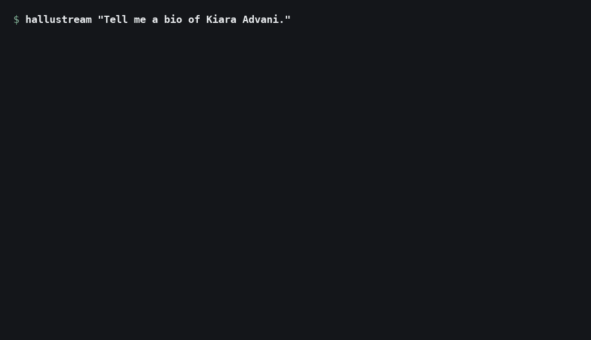
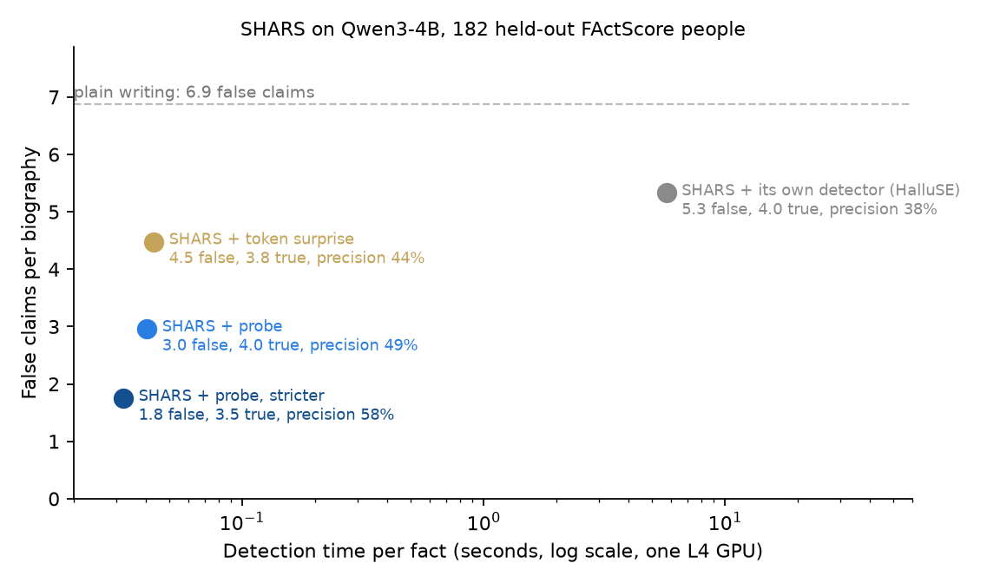

# HalluStream

**A near-free hallucination detector for open LLMs.** A small linear probe reads a model's hidden states while it writes and flags the names, dates, places and titles it is probably making up. It generates no extra text, needs no web search, and adds about 5% to generation time.

**[See it work on the project page](https://pranav-sethia.github.io/hallustream/)**: real runs replayed with live flags, the SHARS comparison, and the accuracy and threshold charts.

*A real, unedited run (Qwen3-4B, greedy decoding). The flags land on invented facts: her birth date, her mother, a brother, and films and years she was never in.*

## Results
**Inside SHARS (ICML 2026), the probe beats SHARS's own detector.** [SHARS](https://arxiv.org/abs/2606.03628) writes sentence by sentence: it splits each sentence into facts, asks a detector which facts are made up, and keeps, rewrites or redoes the sentence. Its detector, HalluSE, asks the model a question about every fact and samples several answers. We replaced HalluSE with the probe and changed nothing else. Results on all 182 of SHARS's FActScore people (none in the probe's training data), with Qwen3-4B, pre-registered:

| Per biography | Plain writing | SHARS + HalluSE | **SHARS + probe** |
|---|---|---|---|
| True claims | 3.2 | 4.1 | **4.0** |
| False claims | 6.9 | 5.3 | **3.0** (−44%) |
| Precision | 29% | 38% | **49%** |
| Detection time per fact | – | 5.7 s | **0.04 s** (~140× less) |
| Total time per biography | 7 s | 211 s | **49 s** |

False claims are claims the fact checker could not support from the person's Wikipedia page (FActScore's convention). False claims: −2.37 per person, 95% interval [−2.96, −1.80]. Precision: +0.083 [+0.038, +0.132]. True claims: unchanged. Counting only specific details (names, places, dates, numbers), false ones drop 49% (2.74 → 1.41) and true ones are unchanged.

**Compared with the paper it builds on** ([Obeso et al., 2025](https://arxiv.org/abs/2509.03531)):

| | Paper | HalluStream |
|---|---|---|
| Paper's own benchmark: Qwen2.5-7B, its own training data and test sets, AUROC (LongFact / LongFact++) | linear probe 0.839 / 0.847 | **0.894 / 0.897**, +0.05 [95% intervals above +0.04] |
| Same benchmark, the paper's best method (LoRA fine-tuning of the model) | 0.895 / 0.896 | **matched with the model's weights untouched** |
| Made-up details caught at a 10% false-alarm rate (same benchmark) | 54% / 55% (LoRA: 66% / 68%) | **68% / 69%** |
| On Qwen3-4B's own biographies (600 untouched people), AUROC | paper's recipe 0.776 | **0.854** (adapted to the model's own writing) |
| Inside SHARS (182 people), false claims per biography | paper's recipe 4.70 | **2.96**, with 0.94 more true claims |

The gains come from choices tested on validation data: reading a middle layer (layer 18 of 28) instead of the last ones, tuned training, and a cheap adaptation to the model's own answers. Details: [RESULTS.md](docs/RESULTS.md).

**The detector on its own** (AUROC: how often a made-up fact scores higher than a true one; 0.5 is chance):

| | Probe | Model's own confidence |
|---|---|---|
| Qwen3-4B's own biographies, 600 untouched people | **0.854** | 0.690 |
| Qwen3-4B's own writing about 496 other subjects (places, organizations, events, works, species) | **0.834** | 0.668 |
| Long answers on many topics (144,676 held-out details) | **0.854** | 0.678 |

Example from the test (Adil Rami, French footballer, 2018 World Cup winner). Counting the names, places, dates and clubs the fact checker could check:
- Qwen3-4B alone made up 10, including a birth date, a birthplace and five clubs he never played for (AS Monaco, Paris Saint-Germain, Tottenham, Nantes, Metz).
- SHARS + HalluSE still kept 3 fake clubs.
- SHARS + probe kept none. The probe flagged the fake birth date at 98% risk and the fake clubs at 60–95%.

## How it was evaluated
- Every test's settings, metrics and pass bars were committed in [EVAL_PROTOCOL.md](EVAL_PROTOCOL.md) before its outputs existed. Amendments are dated there with their reasons.
- Settings were chosen on separate dev people, and each test set was scored once. Paired bootstrap intervals are over people.
- Leak checks: none of the test people appear in the probe's training data or in the data used to adapt it.
- Labels come from a fact checker validated against human labels (89% balanced accuracy on 11,049 facts) and re-checked blind by a second model (91% agreement).

## Limits
- It needs the model's hidden states, so it works on open-weight models, and each model needs its own probe.
- It holds back what the model would make up; it cannot add knowledge the model lacks. Retrieval does that when a source is available.
- The SHARS test is on biographies (FActScore, the standard benchmark); the detector itself was also tested on 496 other subjects.
- Our fact checker is stricter than SHARS's GPT-5 FActScore setup, so absolute precision is lower than in their paper. Every method shares the same fact checker.

## Repository
- `src/hallustream/`: the library (`detector.py`, `probe.py`, `entities.py`, `cli.py`, `integrations/shars.py`, bundled `weights/`)
- `src/hallustream/research/`: data, probe training, evaluation, the fact checker (`factcheck/`), SHARS analysis
- `modal_jobs/`: GPU and batch jobs on Modal (feature extraction, training, biographies, judge batches, SHARS runs)
- `configs/`: frozen choices, detector weights and fixed people lists
- `notebooks/`: the Colab quickstart
- `tests/`: unit tests; CI runs ruff, pyright and pytest on Python 3.10 and 3.12

Data sources and licenses: [docs/DATA.md](docs/DATA.md).

## Builds on
- Obeso et al., [Real-Time Detection of Hallucinated Entities in Long-Form Generation](https://arxiv.org/abs/2509.03531) (2025): the probe method and training data
- Li et al., [Building Reliable Long-Form Generation via Hallucination Rejection Sampling](https://arxiv.org/abs/2606.03628) (ICML 2026): SHARS
- Min et al., [FActScore](https://arxiv.org/abs/2305.14251) (2023): people and human labels

## License
Apache-2.0
