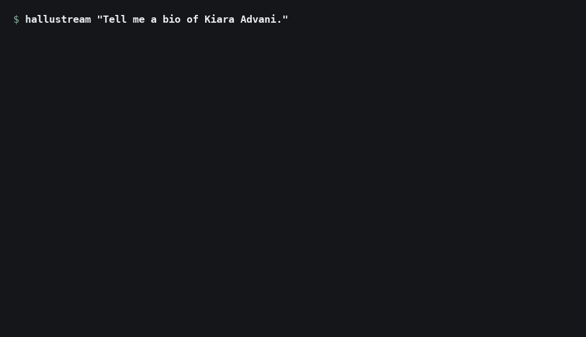
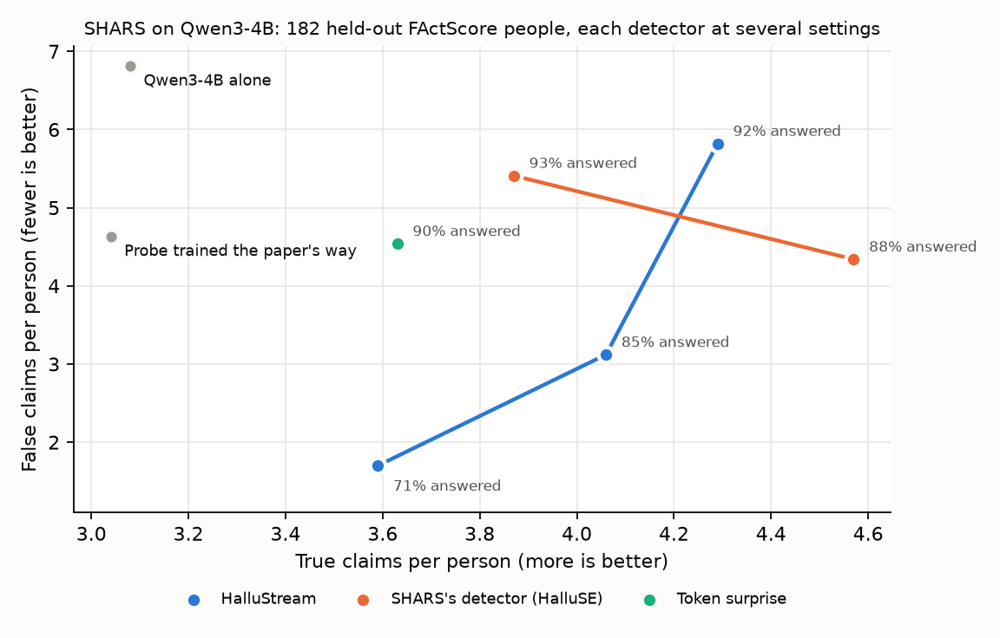

# HalluStream

[](https://github.com/pranav-sethia/hallustream/actions/workflows/ci.yml)
[](https://colab.research.google.com/github/pranav-sethia/hallustream/blob/main/notebooks/quickstart.ipynb)

HalluStream catches a language model making things up while it writes. A small linear probe reads the model's hidden states and flags the names, dates, places and titles it is probably inventing. It doesn't generate extra text or search the web, and it adds about 3–7% to generation time.

The [project page](https://pranav-sethia.github.io/hallustream/) replays real runs with the flags appearing live.



*A real, unedited run with Qwen3-4B (recorded with the previous version of the detector). The flags land on invented facts: her birth date, her mother, a brother, and films and years she was never in.*

## Quick start

```bash
pip install "hallustream[entities] @ git+https://github.com/pranav-sethia/hallustream"
hallustream "Tell me about A Caribbean Mystery."
```

That answers the question and highlights the details that are likely made up. There is also `hallustream chat`, `score` for checking an answer the model already wrote, and `batch` for whole files. From Python:

```python
from hallustream import Detector

det = Detector.from_pretrained("qwen3-4b")
report = det.generate("Tell me a bio of Kiara Advani.")
print(report.summary())
```

It needs a GPU or an Apple Silicon Mac for Qwen3-4B, and Python 3.10 or newer. The [Colab notebook](https://colab.research.google.com/github/pranav-sethia/hallustream/blob/main/notebooks/quickstart.ipynb) runs on the free tier. More in [LIBRARY.md](https://github.com/pranav-sethia/hallustream/blob/main/docs/LIBRARY.md).

## Results

Every test below was written down in [EVAL_PROTOCOL.md](https://github.com/pranav-sethia/hallustream/blob/main/EVAL_PROTOCOL.md) before it was run, choices were made on separate validation data, and each test set was scored once. The details are in [RESULTS.md](https://github.com/pranav-sethia/hallustream/blob/main/docs/RESULTS.md).

### Against the paper it builds on

The probe comes from [Obeso et al. (2025)](https://arxiv.org/abs/2509.03531), who released probes for several models. I ran their released probes through my own pipeline, then changed two things: the layer is picked on validation instead of fixed near the end, and the training is tuned on validation. The model is never changed. On the paper's own data and test sets, scored on exactly the same details as the paper's released probes:

| AUROC on LongFact / LongFact++ | Paper's linear probe | Paper's LoRA probe (fine-tunes the model) | HalluStream |
|---|---|---|---|
| Qwen2.5-7B | 0.839 / 0.847 | 0.884 / 0.889 | **0.894 / 0.896** |
| Llama-3.1-8B | 0.848 / 0.862 | **0.889 / 0.900** | 0.872 / 0.891 |

HalluStream beats the paper's linear probe on both models (+0.050 to +0.055 on Qwen2.5-7B, +0.024 to +0.029 on Llama-3.1-8B), and on Qwen2.5-7B it also beats the probe that fine-tunes the model (+0.010 / +0.008). On Llama-3.1-8B, the model with the most training data in the paper, fine-tuning still wins (by 0.017 / 0.009). On the paper's HealthBench set of medical answers, never used here before, the same holds: 0.874 against 0.849 (linear) and 0.892 (LoRA). Every difference holds at 95% confidence.

### On the model's own writing

The paper trains on other models' answers. HalluStream also adapts the probe to the model's own writing. Tested on Qwen3-4B's texts about people and other subjects drawn fresh from Wikipedia after the detector was frozen:

| AUROC | 437 new people | 498 new subjects |
|---|---|---|
| The model's own confidence (max entropy) | 0.660 | 0.684 |
| The paper's recipe on Qwen3-4B | 0.814 | 0.780 |
| **HalluStream** | **0.874** | **0.854** |

Comparing only details about the same subject, which removes the easy part of telling obscure subjects from famous ones, HalluStream still leads the model's confidence 0.87 to 0.75 and 0.85 to 0.75. Its risk reads as a probability: of the details it gives 90–100% risk, 96% are unsupported.

### Inside SHARS

[SHARS](https://arxiv.org/abs/2606.03628) (ICML 2026) reduces hallucination by writing an answer one sentence at a time and redoing sentences whose facts look doubtful. Its own detector samples extra answers for every fact. I swapped in HalluStream, changed nothing else, and ran both detectors at several settings on all 182 of SHARS's test people:



The two detectors trace about the same trade-off between true and false claims, and HalluStream gets there 4.5–6x faster end to end (34–49 s per biography against 211–222 s), with about 140x less time spent on detection. At the same answer rate it has the same numbers of true and false claims; set more cautiously it goes further, down to 1.7 false claims per person. A first comparison reported 44% fewer false claims than SHARS's detector; that compared a cautious HalluStream setting with a permissive one of SHARS's, and the runs at matched settings above replace it.

## How it was tested

- **Pre-registered:** each test's settings and pass bars were committed before it ran. Experiments that were stopped are kept in the protocol's appendix with their outcomes.
- **Reproduced first:** the paper's released Qwen2.5-7B probe, run through this pipeline, gives 0.8384 / 0.8469 against the published 0.8383 / 0.8467.
- **Fresh test data:** the own-writing test used 1,100 people and subjects sampled after the detector was frozen.
- **A validated fact checker:** labels come from Gemini reading the subject's Wikipedia page. Against FActScore's human labels it gets 89% balanced accuracy on 11,049 facts. A stronger model re-checking its labels blind agreed on 84–91%; it marks made-up details reliably and leans toward accepting doubtful ones.

## Limits

The probe needs the model's hidden states, so it works on open-weight models, and each model needs its own probe; the bundled one is for Qwen3-4B-Instruct-2507. It holds back what the model would make up but can't add facts the model doesn't know; when a source is available, retrieval does that better (an early pilot here reached 96% precision by retrieving the person's Wikipedia page). The own-writing labels come from a fact checker that only reads Wikipedia, and the adapted probe was fitted on that checker's labels; a stronger judge did not confirm its precision gains inside SHARS.

## Repository

- `src/hallustream/`: the library (detector, probe, entity finder, CLI, SHARS plug-in, bundled weights)
- `src/hallustream/research/`: data, training, evaluation, the fact checker and the analysis scripts
- `modal_jobs/`: the GPU and batch jobs, run on Modal
- `configs/`: frozen settings and fixed lists of people and subjects
- `results/public/`: labels, scores and texts behind every reported number
- `notebooks/`: the Colab quickstart
- `tests/`: unit tests and a package install test, run in CI

Data sources and licenses are in [DATA.md](https://github.com/pranav-sethia/hallustream/blob/main/docs/DATA.md).

## Credits

- Obeso et al., [Real-Time Detection of Hallucinated Entities in Long-Form Generation](https://arxiv.org/abs/2509.03531) (2025): the probe method, training data and released probes
- Li et al., [Building Reliable Long-Form Generation via Hallucination Rejection Sampling](https://arxiv.org/abs/2606.03628) (ICML 2026): SHARS
- Min et al., [FActScore](https://arxiv.org/abs/2305.14251) (2023): the people and human labels

To cite this project, see [CITATION.cff](https://github.com/pranav-sethia/hallustream/blob/main/CITATION.cff).

## License

Apache-2.0
