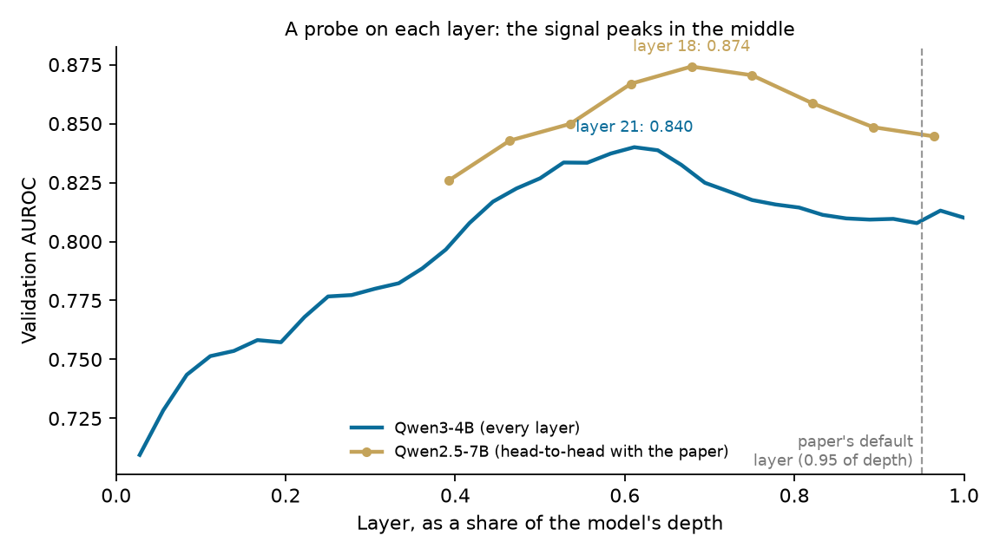

# Results

All numbers are generated from logged runs (`data/gate/gate_results.json`, `sweep_results.json`), not typed by hand.

## Reproduction check
We ran Obeso et al.'s released linear probe (`obalcells/hallucination-probes`, `qwen2_5_7b_linear`) through this project's own pipeline on Qwen2.5-7B-Instruct and compared against the paper's Table 4. Span-level AUROC: each entity is scored by its highest token probability.

| Test set | Paper | Ours (paper-style span search) | Recall @ 10% FPR (ours) | Ours (exact character offsets) | Entities scored (exact) |
|---|---|---|---|---|---|
| LongFact | 0.8383 | 0.8384 | 0.5436 | 0.8387 | 14,416 |
| LongFact++ | 0.8467 | 0.8469 | 0.5532 | 0.8467 | 10,117 |

With the paper's span search, our pipeline reproduces the published numbers to within 0.0002 AUROC. The project's exact-offset labeling (used for all training) lands within 0.0004 of the paper while keeping every labeled entity and always labeling the correct mention of repeated names.

## Layer sweep
**Setup**
- Every layer of both models, on 1,200 train / 800 validation answers (11,414 validation entities).
- Each candidate gets the same linear probe: L2 logistic regression on standardized features with balanced classes. Its regularization strength (C = 3e-5) was tuned on the best candidates first. The default C = 1 overfit and cost about 0.01 AUROC.
- Candidates are compared with a paired bootstrap that resamples validation questions.
- Everything here uses validation data only.

**Shape of the curve**
- In both models the signal rises smoothly from the first layer, at about 0.71–0.72 AUROC.
- It peaks at about 55–60% of depth: **Qwen3.5-4B layer 17 (0.843)** and **Qwen3-4B layer 21 (0.840)**.
- It then falls to about 0.81–0.82 in the last layers.
- There are no isolated spikes.
- In Qwen3.5, the full-attention layers (circled in the chart) sit on the same curve as the Gated DeltaNet layers around them.
- The best confidence baselines on the same entities score only 0.62–0.67: maximum token surprise and maximum entropy.

**Layer combinations** (22 per model)

| Combination type | Best example, Qwen3.5 | vs best single layer |
|---|---|---|
| Neighbors (e.g. 16+17, 20+21) | 16+17: 0.843 | no gain |
| Runs of 3–4 neighbors | 16+17+18: 0.843 | no gain |
| Spread out (e.g. 11+17+23) | 13+17+21: 0.842 | no gain |
| Average of a band of layers | mean(15..19): 0.842 | no gain |
| Middle + last layers | 17+30: **0.847** | +0.004 (interval above 0), but recall at 10% FPR not higher |

- For Qwen3, no combination beat layer 21 beyond noise.
- Whether Qwen3.5 uses layer 17 alone or 17+30 was decided on the full training set (below), by the rule in [EVAL_PROTOCOL.md](../EVAL_PROTOCOL.md).
- Full tables: `results/sweep_report.json`, produced by `research/sweep_report.py`.

## Trained probe
**Training**
- Recipe: Obeso et al.'s annealed loss, which starts as a per-token loss and shifts to a loss on each entity's riskiest token. Entity tokens are weighted 10x. Optimizer: AdamW with linear learning-rate decay.
- Data: all 20,056 training answers.
- Tuned on validation: the paper's loss vs a token-only loss, learning rate, passes over the data, and L2 strength.
  - The annealed loss won in every case, by +0.02–0.025 AUROC.
  - Accuracy plateaued at 8 passes over the data.
  - Learning rate and L2 strength changed AUROC by at most 0.001.
- Layer choice: the rule fixed in [EVAL_PROTOCOL.md](../EVAL_PROTOCOL.md) picked layers 17 + 30 over layer 17 alone for Qwen3.5. On validation, AUROC was +0.008 [0.006, 0.009] higher and recall at 10% FPR was 64.9% vs 63.1%.
- Frozen before test: probe, Platt calibration and thresholds were set on validation only and committed before the test set was scored ([configs/frozen_choices.json](../configs/frozen_choices.json)).

**Test set:** 9,426 answers and 144,676 entities, scored once.

| | Qwen3.5-4B (layers 17+30) | Qwen3-4B (layer 21) |
|---|---|---|
| Entity AUROC (seed 0) | **0.867** | 0.854 |
| AUROC over 5 seeds | 0.8666 ± 0.0002 | 0.8545 ± 0.0002 |
| Best confidence baseline | 0.630 (max surprise) | 0.678 (max entropy) |
| Probe − baseline (95% CI) | **+0.236** [0.230, 0.243] | +0.177 [0.171, 0.183] |
| Recall / precision at the fpr10 threshold | 57.6% / 71.7% (false-alarm rate 9.6%) | 55.9% / 70.2% (10.0%) |
| Recall / precision at the guard threshold | 25.8% / 87.0% (false-alarm rate 1.6%) | 25.1% / 86.2% (1.7%) |
| AUPRC | 0.739 | 0.722 |
| Calibration error (ECE) | 0.016 | 0.012 |
| Ordinary words flagged at the fpr10 threshold | 3.9% | 3.9% |

**Comparisons**
- Qwen3.5 vs Qwen3: +0.012 AUROC [0.011, 0.014], paired bootstrap over test questions.
- Both probes pass the protocol's main-result bar (≥ +0.05 over the best baseline, interval above 0) by a wide margin.

**By test set and by the model that wrote the answer (Qwen3.5 probe)**

| | LongFact | LongFact++ | Llama-3.3-70B | Llama-3.1-8B | Mistral-24B | Qwen2.5-7B | Gemma-2-9B |
|---|---|---|---|---|---|---|---|
| AUROC | 0.859 | 0.878 | 0.859 | 0.873 | 0.868 | 0.883 | 0.880 |

**Notes**
- Test AUROC is about 0.018 below validation (0.867 vs 0.885). Validation questions come from the same pool as training; test questions are separate.
- The paper's own Qwen2.5-7B linear probe scored 0.838 / 0.847 on these test sets. Its setting is different (one model probing its own answers), so it is context rather than a head-to-head comparison.
- The guard's stop rate on whole answers needs full token streams. It will be measured with the streaming library.

## Own-answer gate: biographies
**Question:** the probe was trained on text written by other models. Does it catch hallucinated entities in biographies the model writes itself? The setup and pass rule were fixed in advance in [EVAL_PROTOCOL.md](../EVAL_PROTOCOL.md).

**Fact checker (checked against FActScore's human labels; 143 reported people, kept apart from the 40 used to pick settings):**
- Judge: `gemini-3.1-flash-lite` (Batch API), with the person's Wikipedia page as evidence.
- Labeling the humans' own facts: balanced accuracy **0.890** (bar 0.80), on 11,049 facts.
- FActScore with the judge's own fact splitting, compared with the human score:

| | Human | Judge | Error (bar 0.03) |
|---|---|---|---|
| InstructGPT | 0.420 | 0.397 | 0.023 |
| ChatGPT | 0.588 | 0.575 | 0.013 |
| PerplexityAI (reported only) | 0.811 | 0.745 | 0.067 |

- Entity labels vs facts the humans marked: balanced accuracy 0.913 (5,669 entities).

**Gate:** 500 FActScore people, `Tell me a bio of {name}.`, greedy decoding. Entity AUROC is Not Supported vs Supported, using the mean of the 5 frozen probe seeds. The 95% intervals come from a bootstrap over people.

| | Qwen3-4B (layer 21) | Qwen3.5-4B (layers 17+30) |
|---|---|---|
| Biographies scored (others said they did not know the person) | 404 | 485 |
| Entities (share Not Supported) | 4,478 (56%) | 7,579 (75%) |
| **Probe AUROC** | **0.828** [0.809, 0.847] | 0.804 [0.781, 0.825] |
| Frozen baseline AUROC | 0.759 (max entropy) | 0.776 (max surprise) |
| Probe − baseline | **+0.069** [0.045, 0.093] | +0.028 [0.008, 0.047] |
| People never seen in probe training | 0.839 (161 people) | 0.814 (192 people) |
| People seen in probe training | 0.821 (243 people) | 0.798 (293 people) |
| Same 398 people for both models | 0.828 | 0.813 |

**Result: passes** (Qwen3-4B AUROC 0.828, bar 0.75). Next comes detect→fix on Qwen3-4B.

**Notes**
- People the probe saw in training do not score higher. The unseen people actually score slightly higher, so the overlap does not inflate the result.
- On the model's own text, the confidence baselines are much stronger (0.76–0.78) than on other models' text (0.63–0.68). The probe's lead shrinks from +0.18–0.24 to +0.03–0.07, and is clearly larger for Qwen3-4B.
- Qwen3.5-4B hit the 512-token limit in 237 of 500 biographies. On the 248 people whose biographies finished, its probe scores 0.712, below the baseline's 0.755. On those people, 84% of entities are Not Supported (75% overall), so it is a small, lopsided subset. The cause is not yet known, and it is one more reason the pipeline uses Qwen3-4B. Qwen3-4B on finished biographies scores 0.839.
- Gemini splits biographies into about half as many claims as FActScore's annotators did. Judge FActScores are therefore comparable across our own runs, not with published FActScore numbers.
- Checks: 0.3–0.5% of judged entities could not be found in the text, and teacher forcing reproduced 98.9% of the greedy tokens.

## Own-answer detector v2 (tuned on new people, tested once on the gate people)
**Why:** on a model's own text, its confidence is a stronger signal than on other models' text, and v1 ignores it. The protocol in [EVAL_PROTOCOL.md](../EVAL_PROTOCOL.md) was committed before any new data existed: candidates are chosen on new people and scored once on the 500 gate people.

**Dev people:**
- 1,200 Wikidata humans drawn from random Wikipedia pages, stratified by popularity, with none of the gate people, labeled people, or anyone named in the probe's training questions. 42 of the 600 dev people are mentioned somewhere in the training *answers*; dev is for choosing, not testing, so they were kept ([configs/dev_people.json](../configs/dev_people.json)).
- 600 were used here; Qwen3-4B answered 432 of them, giving 3,373 judged entities.

**Judge audit on Qwen's own text:**
- `gemini-3.5-flash` re-judged 300 dev entities with the whole Wikipedia page.
- Supported vs Not Supported agreement: 0.856 (bar 0.85) on a sample with 100 entities per label; weighted to dev's actual mix of labels it is about 0.90. When the judge says Not Supported, the audit model agrees 96% of the time; it disputes 28 of 98 of the judge's Supported labels.
- Of those 28, about 20 are the audit model marking a correct entity wrong because of a different error in the same sentence (for example, a person's name when their birth date is wrong), which is not the per-entity labeling the probe was trained on; about 3 are audit-model mistakes, and about 3–4 are real judge misses. The judge was kept.

**Candidates, 5-fold cross-validation by person on dev:**

| Candidate | AUROC | Gain over v1 (95% CI) |
|---|---|---|
| v1 (frozen probe) | 0.800 | — |
| **A: probe + confidence signals (logistic regression)** | **0.840** | **+0.040 [0.029, 0.051]** |
| B: probe refit on own answers (hidden states) | 0.808 | +0.008 [−0.018, 0.032] |
| C: A + B | 0.791 | −0.010 [−0.040, 0.018] |
| D: mean / last-token aggregation | 0.777 / 0.752 | −0.024 / −0.049 |

A was chosen, refit on all dev people and frozen ([configs/detector_v2.json](../configs/detector_v2.json)). One input, the entity's position relative to the finished biography, is not known while the model is still writing; dropping it changes dev AUROC by less than 0.001, and later detectors leave it out.

**Correction:** B and C lost here because their hidden-state penalty grid stopped at 1.0, its edge (every fold chose it), and the fit memorized the training folds. With stronger penalties B is clearly better on dev, so "refitting on own answers does not help" was wrong; see detector v3 below.

**Gate people (Qwen3-4B, 404 people, 4,478 entities), scored once:**

| | AUROC | vs max-entropy baseline (0.759) |
|---|---|---|
| v1 (pre-registered) | 0.828 [0.809, 0.847] | +0.069 [0.045, 0.093] |
| **v2** | **0.866** [0.850, 0.880] | **+0.107** [0.091, 0.123] |
| v2 − v1 | +0.038 [0.028, 0.048] | |
| v2, people unseen in probe training | 0.883 (161 people) | |
| v2, seen | 0.855 (243 people) | |
| v2, finished biographies | 0.870 (355 people) | |

The gain on the gate people (+0.038) matches the cross-validated gain on dev (+0.040), so the choice did not overfit.

**Reader mode (scoring other models' text):** the same kind of combiner, cross-validated by answer on the probe's validation set (2,394 answers, 34,314 entities written by 5 other models), adds almost nothing: +0.002 [0.001, 0.002] for Qwen3-4B (0.872 → 0.873) and +0.001 for Qwen3.5-4B (0.885 → 0.886). The model's confidence about someone else's text is a weak signal (0.62–0.67), and the fitted formula puts nearly all its weight on the probe. Reader mode therefore uses the probe alone; detector v2 is for the model's own writing.

## Detector v3 and the final check on untouched people
**Why:** an audit of v2's selection found the penalty grid for refitting on own answers too weak (see the correction above). The fix and the final check were pre-registered in [EVAL_PROTOCOL.md](../EVAL_PROTOCOL.md) before any reserved biography was generated.

**Choice on the same 432 dev people** (nested 5-fold cross-validation by person; reference = v2's recipe, 0.840):

| Candidate | AUROC | Gain over v2's recipe |
|---|---|---|
| A without position | 0.841 | +0.001 [−0.001, 0.002] |
| **B: v1 + linear term on the layer-21 hidden state, L2 1,000** | **0.879** | **+0.039 [0.029, 0.050]** |
| C: B + confidence signals | 0.886 | +0.046 [0.036, 0.057] |

The rule picks the simplest qualifying candidate: B, frozen in [configs/detector_v3.json](../configs/detector_v3.json). It reads only the hidden state the probe already uses, so it works while the model writes.

**Final check: the 600 reserved people, untouched until now** (Qwen3-4B answered 477; 3,727 judged entities, 61% Not Supported), each detector scored once:

| | AUROC |
|---|---|
| Max entropy (model confidence) | 0.690 [0.668, 0.711] |
| v1 (frozen probe) | 0.776 [0.751, 0.800] |
| v2 (probe + confidence) | 0.818 [0.798, 0.839] |
| **v3 (probe adapted to own answers)** | **0.854** [0.834, 0.873] |
| v3 − v2 | +0.036 [0.025, 0.047] |
| v3 − v1 | +0.078 [0.064, 0.091] |
| v3 − max entropy | +0.164 [0.138, 0.192] |

v3's gain over v2 on untouched people (+0.036) matches its cross-validated gain on dev (+0.039). **v3 is the detector for detect→fix on Qwen3-4B's own writing.** Reader mode (other models' text) keeps the frozen probe, v1.

Absolute AUROCs are lower on these people than on FActScore's gate people (v1 0.776 vs 0.828; max entropy 0.690 vs 0.759). The dev and reserved people come from random Wikipedia pages and are mostly obscure, and every detector, including the baseline, drops by about the same amount.

## SHARS with the probe as its detector (test, 60 people)
**Question:** [SHARS](https://arxiv.org/abs/2606.03628) (ICML 2026) writes a biography sentence by sentence. Each sentence is split into facts, a detector scores every fact, and the sentence is then kept, rewritten from its trusted facts, or redone. SHARS's own detector, HalluSE, asks a question about each fact and samples answers. Does v3 work better as the detector, at a fraction of the cost?

**Setup:**
- Model: Qwen3-4B-Instruct-2507, using SHARS's code unchanged (`third_party/shars`) apart from the detector.
- Settings: SHARS's Following policy, rewriting on, 10 tries per sentence.
- People: the first 60 of a fixed random order of SHARS's 182 FActScore people. None of them appear in the probe's training data.
- Labels: every biography is labeled by the validated biography judge.
- Detector settings were chosen on separate dev people. They and the claims below were fixed in [EVAL_PROTOCOL.md](../EVAL_PROTOCOL.md) before any test output.

| Per person (60) | Greedy | SHARS + HalluSE | **SHARS + v3** | SHARS + v3, stricter | SHARS + token surprise |
|---|---|---|---|---|---|
| Supported claims | 3.10 | 3.98 | **4.03** | 3.63 | 3.82 |
| Unsupported claims | 6.95 | 5.20 | **3.33** | 1.55 | 4.25 |
| Precision (answered) | 0.284 | 0.382 | **0.475** | 0.590 | 0.442 |
| Answered | 88% | 90% | 85% | 72% | 88% |
| Specific unsupported claims¹ | 4.10 | 2.78 | **1.62** | 0.78 | 2.10 |
| Detection seconds per fact | – | 5.76 | **0.051** | 0.030 | 0.037 |
| Seconds per biography (L4) | 7.5 | 231.6 | **59.5** | 37.9 | 38.4 |

¹ claims with a number or a capitalized word that isn't the person's name (places, titles, dates); a rough split from generic claims like "has been active in the entertainment industry".

**SHARS + v3 vs SHARS + HalluSE (paired over the 60 people):**

| | Difference [95% interval] |
|---|---|
| Unsupported claims | **−1.87 [−2.75, −0.95]** (−36%) |
| Supported claims | +0.05 [−0.70, +0.83] |
| Precision (51 people answered by both) | +0.086 [−0.005, +0.185] |
| Specific unsupported claims | −1.17 [−1.65, −0.65] |
| Specific supported claims | −0.08 [−0.40, +0.25] |

- **Fewer false claims than SHARS's own detector: yes.** About a third fewer unsupported claims at the same number of supported claims.
- **Matches it on precision: yes.** The interval stays above −0.05. Higher precision is likely but not established at this sample size.
- **Detection cost: about 110× lower.** That's 0.051 vs 5.76 s per fact, or 1.7 vs 186 s per biography. SHARS runs end to end 3.9× faster.
- **The stricter v3 setting** cuts unsupported claims by 70% (−3.65 [−4.65, −2.67]) with precision +0.16 [+0.07, +0.26]. It keeps 91% of HalluSE's supported claims but answers fewer people (72% vs 90%).
- **Against the free token-surprise signal** at the same dev flag rate, v3 has fewer unsupported claims (−0.92 [−1.92, +0.13]) and slightly higher precision (+0.03), but neither difference is established. Surprise also beats HalluSE on unsupported claims (−0.95 [−1.72, −0.20]). In SHARS on this model, the cheap internal signals are at least as useful as sampling answers.
- **Rewriting:** across 650 rewrites in all arms, none kept a flagged fact; 6–10% dropped a trusted one.
- **Caveat:** SHARS often replaces a removed false claim with a generic true one. The specific-claim rows show that v3 removes specific false claims without losing specific true ones.

Step 1 on 40 separate dev people (greedy vs SHARS + v3, plus rewriting on vs off) is in the protocol.
