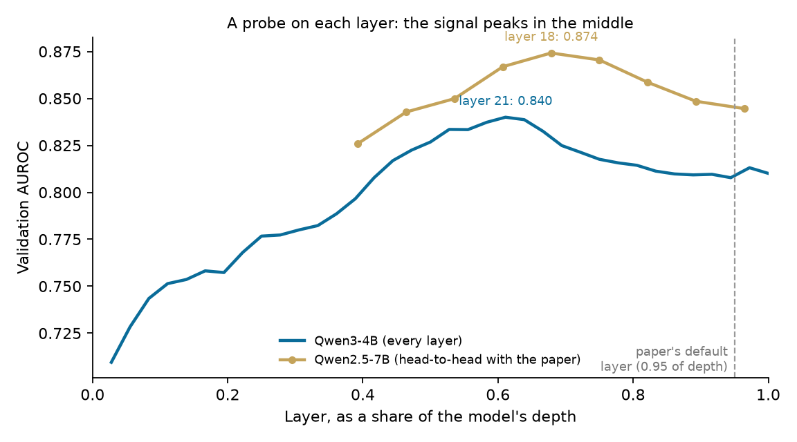
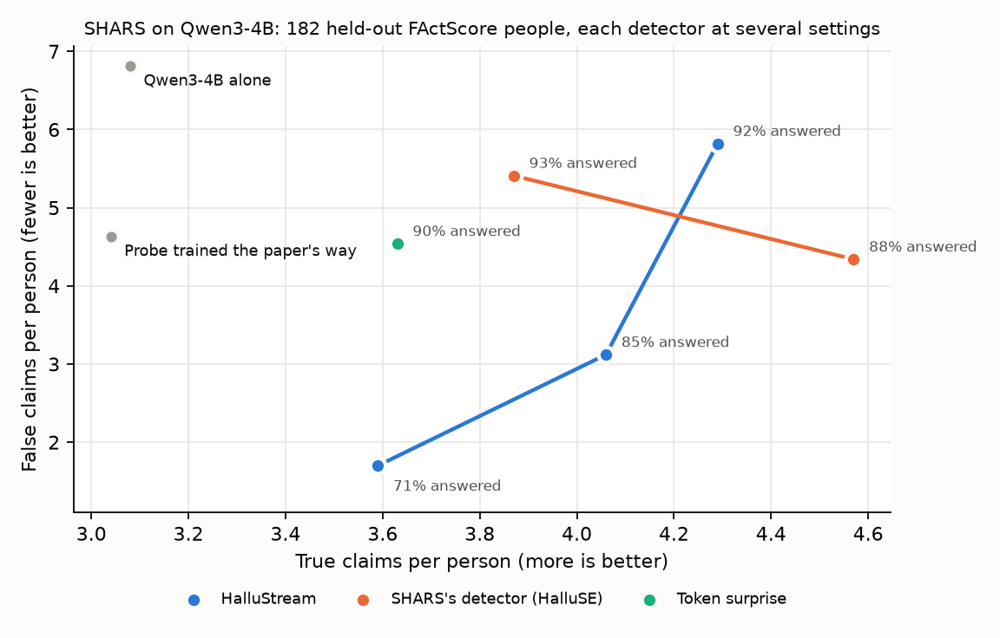

# Results

Every number here comes from logged runs and the scripts named in each section. Each test's settings and pass bars were written in [EVAL_PROTOCOL.md](../EVAL_PROTOCOL.md) before it was run. Choices were made on validation or dev data, and each test set was scored once. Intervals are 95% paired bootstrap intervals (2,000 resamples unless noted).

In short:

- On the benchmark of the paper it builds on (Obeso et al. 2025), the paper's released Qwen2.5-7B probe reproduces its published scores in this pipeline. Picking the layer and the training settings on validation adds 0.024 to 0.055 AUROC to their linear probes on Qwen2.5-7B and Llama-3.1-8B, without changing the model. That brings a probe on the unchanged model within 0.02 of their LoRA probes, which fine-tune it: slightly above on Qwen2.5-7B, below on Llama-3.1-8B.
- On Qwen3-4B's own writing about people and other subjects sampled after the detector was frozen, it scores 0.874 and 0.854 AUROC, against 0.660 and 0.684 for the model's own confidence.
- Inside SHARS (ICML 2026), it traces about the same trade-off between true and false claims as SHARS's own detector, 4.5–6x faster end to end. An earlier comparison at different settings is replaced by this one (see Inside SHARS).

Intervals are over people, subjects or answers; the base probe's is over questions with 1,000 resamples. Some of this was added after an audit of the finished project, which is marked where it applies (EVAL_PROTOCOL.md, follow-ups).

## Building on the paper, on its own benchmark

Obeso et al. released two probes for each of several models. For Qwen2.5-7B-Instruct: a linear probe that reads layer 26 of 28 (their default, about 0.95 of the depth), and a LoRA probe that also fine-tunes the model's layers up to that point. I kept everything else from the paper's setting and asked how far a probe on the unchanged model could go with two changes: the layer it reads and its training settings.

The model stays frozen. Training uses the paper's own annotations of Qwen2.5-7B's answers: 1,625 answers from the official train split, with the 178-answer validation split for every choice, and the official test split scored once at the end. The layer was picked on validation with the same sweep I used for Qwen3-4B (chart below): layer 18 scored 0.874 against 0.845 for layer 26. Training uses the paper's annealed loss, with the learning rate, number of passes and L2 strength tuned on validation, and the scores of 5 seeds are averaged.

All three probes are scored on exactly the same details, by the same code. The paper's probes, run through it, give the numbers they report themselves: 0.8387 / 0.8467 for the linear probe (published 0.8383 / 0.8467) and 0.884 / 0.889 for the LoRA probe (its own evaluation file).

| | LongFact (14,416 details) | LongFact++ (10,117) |
|---|---|---|
| Paper's released linear probe (layer 26), re-run | 0.839 (54% caught) | 0.847 (55% caught) |
| Paper's released LoRA probe (fine-tunes the model), re-run | 0.884 (64% caught) | 0.889 (65% caught) |
| My recipe at layer 26 | 0.870 | 0.880 |
| My recipe at layer 18 | 0.894 (68% caught) | 0.896 (69% caught) |
| Difference from the linear probe | +0.055 (0.049 to 0.062) | +0.050 (0.043 to 0.057) |
| Difference from the LoRA probe | +0.010 (0.006 to 0.014) | +0.008 (0.003 to 0.013) |

"Caught" is the share of made-up details flagged at the point of the curve with 10% false alarms. The 5 seeds alone score 0.888 to 0.890 on LongFact and 0.890 to 0.893 on LongFact++, so the result doesn't rest on one seed. About +0.03 of the gain over the linear probe comes from the tuned training at the same layer, and +0.017 to +0.024 from reading a middle layer. The paper reads a layer near the end (about 95% of the depth); earlier probing work (Azaria and Mitchell 2023; Kossen et al. 2024; Orgad et al. 2025) found middle layers best, and the sweep here agrees.

The paper's best number for this model is a LoRA probe with a different setting that was not released (their Table 4 in the current arXiv version: 0.895 / 0.896, 66% / 68% caught). The frozen probe here scores about the same. That comparison uses the published values, so it has no interval.

**A second model.** The same recipe on Llama-3.1-8B-Instruct, against the paper's released linear probe (layer 30) and its released LoRA probe (`llama3_1_8b_lora_lambda_lm_0_01`, layer 31), pre-registered as follow-ups B2. Llama has 8,429 training answers in the paper's data against 1,625 for Qwen2.5-7B. The validation sweep over every second layer from 10 to 30 picked layer 12 (0.846 on validation against 0.830 for the paper's layer 30), and the same tuning grid picked the same settings at both layers. The paper's HealthBench annotations of Llama's answers to medical questions are a third test set, never used for anything here before.

| | LongFact (18,443 details) | LongFact++ (12,445) | HealthBench (9,008) |
|---|---|---|---|
| Paper's released linear probe, re-run | 0.848 | 0.862 | 0.849 |
| Paper's released LoRA probe, re-run | 0.889 | 0.900 | 0.892 |
| My recipe at layer 30 | 0.866 | 0.886 | 0.859 |
| My recipe at layer 12 | 0.872 | 0.891 | 0.874 |
| Difference from the linear probe | +0.024 (0.020 to 0.029) | +0.029 (0.023 to 0.035) | +0.025 (0.016 to 0.034) |
| Difference from the LoRA probe | −0.017 (−0.021 to −0.014) | −0.009 (−0.013 to −0.004) | −0.018 (−0.025 to −0.012) |

The recipe improves on the linear probe on all three test sets, including the medical one, which was the pre-registered claim. On this model the LoRA probe stays ahead. One possible factor is training data: the paper has about five times more answers for Llama, and fine-tuning may gain more from it than a frozen probe does. Subsampling Llama's training set would test this. Run through this pipeline, the paper's two Llama probes score 0.004 to 0.007 below their published values (0.854 / 0.868 / 0.856 and 0.894 / 0.904 / 0.896); every probe here is scored by the same code on the same details, so the comparison stays like for like.

The code is `modal_jobs/extract.py` (runs `main_qwen25`, `sweep_llama31`, `main_llama31`), `modal_jobs/sweep.py`, `modal_jobs/train.py` (variants `qwen25_*`, `llama31_*`), `modal_jobs/gate.py` (the paper's probes) and `research/paper_h2h.py`.

In both models the signal peaks at about 60–70% of the depth and falls off toward the last layers (`research/layer_figure.py`).

## Inside SHARS

[SHARS](https://arxiv.org/abs/2606.03628) (Li et al., ICML 2026) writes a biography one sentence at a time. Each sentence is split into facts, a detector scores every fact, and the sentence is kept, rewritten from its trusted facts, or redone. SHARS's own detector, HalluSE, writes a question about each fact, samples answers and compares them with an NLI model. I replaced it with HalluStream and left the rest of SHARS's code, prompt, rewriting and resampling alone, on Qwen3-4B-Instruct-2507 and all 182 of SHARS's FActScore people.

HalluSE was run at its best dev setting: 5 sampled answers plus two options in SHARS's code that aren't in its paper (`se_w_expected_answer`, and `entail_check`, which also flags a fact whose entity isn't in the largest answer cluster). At θ = 1.676 most of its flags come from that entailment check. Plain HalluSE ranked dev facts at 0.51 AUROC on this model; on first sentences, where the comparison is clean, the chosen setting scored 0.70 against 0.65 for the paper's. Run this way, HalluSE improves on plain Qwen3-4B about as much as SHARS's paper reports for this model (−23% false claims, +26% true at 93% answered, against −21% and +33% in their Table 1). Two setup details apply to every arm: the temperature list starts at 0 rather than the paper's 0.7, and SHARS's sampler draws a sentence's first token at temperature 1 even then.

Each detector was run at several thresholds. Every biography was checked by the fact checker below, with the same Wikipedia passages for every method's text about a person. A false claim is one it couldn't support from the person's page, FActScore's convention. Per person means averaged over all 182 people, a person the method declined to answer counting as zero claims.

| Per person (182) | Answered | True claims | False claims | Precision | Time per biography | Detection per fact |
|---|---|---|---|---|---|---|
| Qwen3-4B alone | 92% | 3.08 | 6.81 | 28% | 7 s | – |
| SHARS + HalluSE, θ = 1.676 | 93% | 3.87 | 5.41 | 36% | 211 s | 5.7 s |
| SHARS + HalluSE, θ = 0.7 | 88% | 4.57 | 4.34 | 47% | 222 s | 4.3 s |
| SHARS + HalluStream, θ = 0.754 | 92% | 4.29 | 5.82 | 41% | 34 s | 0.034 s |
| SHARS + HalluStream, θ = 0.599 | 85% | 4.06 | 3.12 | 48% | 49 s | 0.040 s |
| SHARS + HalluStream, θ = 0.452 | 71% | 3.59 | 1.70 | 58% | 41 s | 0.032 s |
| SHARS + token surprise | 90% | 3.63 | 4.54 | 43% | 52 s | 0.043 s |
| SHARS + probe trained the paper's way | 90% | 3.04 | 4.63 | 33% | 41 s | 0.035 s |

**What it shows.** The two detectors trace about the same trade-off; HalluStream gets there in a fraction of the time.

- At the same answer rate (HalluStream θ = 0.754 against HalluSE θ = 1.676, 92% and 93% answered), true and false claims don't differ reliably (+0.42 true, −0.14 to +0.99; +0.42 false, −0.69 to +1.85), precision is 4.6 points higher (+0.9 to +8.4) and the run is 6.3x faster.
- At the two more cautious settings (85% and 88% answered), HalluStream has 1.21 fewer false claims (0.51 to 2.03) and 0.51 fewer true ones (−1.40 to +0.21), with the same precision (+1.6 points, −3.1 to +6.7), in 4.5x less time.
- HalluStream can go further toward fewer false claims (1.70 per person, 58% precision), answering fewer people.

Detection itself costs 0.04 s per fact against 4–6 s for SHARS's reference HalluSE code (5 answers, unbatched), about 140x less; batching would narrow that.

**The first result, and why it changed.** The protocol's comparison (written 2026-10-26) put HalluStream at θ = 0.599 against HalluSE at θ = 1.676, which flag the same share of dev facts. On the test people that gave 44% fewer false claims (−2.37, −2.96 to −1.80) with the same true claims. But the matching didn't carry over: in the real SHARS loop HalluStream flagged 65% of facts against 50% and answered 85% of people against 93%, so that pair compares two points on the trade-off rather than two detectors. The runs above, added after an audit of the project (EVAL_PROTOCOL.md, follow-ups A), compare them at matched settings.

**Checks.**

- Same passages: the numbers above use one evidence set per person for every method. Judging each text against passages picked by its own wording (the original labels) moves every arm by less than 0.2 claims and changes no conclusion.
- A stronger judge: Gemini 3.5 Flash re-checked 200 random claims from each of three arms against the whole article, blind to arm and label. It agreed with the fact checker on 88% (HalluSE θ = 1.676), 90% (HalluStream θ = 0.754) and 84% (θ = 0.599) of them, but found all three arms equally accurate (36% of claims supported, ± 9 points). So it does not confirm HalluStream's precision gains; with 200 claims per arm it can't rule them in or out. The adapted probe was fitted on this fact checker's labels, which could explain part of them.
- Claude, earlier, re-checked 150 claims blind from the first 60 people's greedy, HalluSE and HalluStream arms, agreeing with the fact checker on 91% (κ 0.83; 94%, 90% and 90% per arm).
- Training overlap: 4 of the 182 people (Roberto Clemente, Harrison Ford, Errol Flynn, Ronaldo) are subjects of questions in the probe's training data. Leaving them out changes nothing (for example −2.34 false claims at θ = 0.599 against θ = 1.676).
- Adaptation matters: the probe trained only the paper's way does worse than HalluSE inside SHARS (33% precision).
- Ranking single facts: on 987 dev facts, HalluStream ranks false facts above true ones better than HalluSE at its best setting (0.74 against 0.64 AUROC, +0.10, 0.04 to 0.16; 0.82 against 0.70 on first sentences). Inside SHARS the gap mostly closes, because SHARS only uses a detector to choose which sentences to redo.

The code is `modal_jobs/shars.py`, `src/hallustream/integrations/shars.py`, `research/shars_test.py` and `research/shars_followup.py`; SHARS itself is vendored unchanged in `third_party/shars` except for one bug fix (`PATCHES.md`).

## The model's own writing

The paper trains its probe on other models' answers. HalluStream adapts it to the model's own writing with a regularized linear term on the layer-21 hidden state, fitted on Qwen3-4B's own texts labeled by the fact checker below. It reads only the hidden state the probe already uses, so it still works while the model writes.

The shipped detector (v4) was fitted on 1,809 subjects (16,127 checked details): Qwen3-4B's biographies of 1,313 people and its texts about 496 other subjects, every own-text set from the earlier checks. Its settings were chosen by cross-validation, and it was frozen and committed before the test below was sampled. The test is new: 600 people and 500 subjects that aren't people, drawn from new random Wikipedia pages and sharing no one and nothing with anything used before. Qwen3-4B answered 437 of the people and 498 of the subjects.

| AUROC | 437 new people (3,296 details) | 498 new subjects (4,822 details) |
|---|---|---|
| Model's own confidence (max entropy) | 0.660 | 0.684 |
| Probe trained the paper's way (v1) | 0.814 | 0.780 |
| **HalluStream (v4)** | **0.874** (0.852 to 0.894) | **0.854** (0.836 to 0.871) |
| HalluStream minus the paper's way | **+0.060** (0.048 to 0.074) | **+0.074** (0.062 to 0.086) |
| HalluStream minus confidence | **+0.214** (0.186 to 0.244) | **+0.170** (0.146 to 0.197) |
| The same, pairs within one subject only | 0.872 against 0.747 | 0.853 against 0.751 |

The last row matters: part of any detector's pooled score comes from telling well-known subjects from obscure ones. Comparing only details from the same subject, the probe still leads the model's confidence by 0.10 to 0.13.

The previous detector (v3) was fitted on 432 people only. On the same new data it scores 0.868 and 0.834, so the extra training data adds +0.006 (0.001 to 0.011) on people and +0.019 (0.013 to 0.026) on other subjects, +0.014 (0.010 to 0.019) together; that was the pre-registered bar for switching the library to v4 (EVAL_PROTOCOL.md, follow-ups C).

| New subjects, by category | HalluStream | Model's confidence |
|---|---|---|
| Living things | 0.820 | 0.599 |
| Events | 0.852 | 0.722 |
| Organizations | 0.881 | 0.688 |
| Creative works | 0.824 | 0.685 |
| Places | 0.871 | 0.698 |

**Earlier checks.** v3's pre-registered tests, each run once before the fresh test existed, are kept as they were:

- **600 reserved people** (477 answered): 0.854 (0.834 to 0.873) against 0.776 for the paper's way and 0.690 for confidence.
- **496 other subjects:** 0.834 against 0.777 and 0.668.
- **FActScore's 500 people,** the first gate: the paper's-way probe v1 scored 0.828 (0.809 to 0.847) against 0.759 for confidence, passing the 0.75 bar, and v2 scored 0.866.

v3 replaced v2 by the pre-registered rule (+0.036 on the reserved people, 0.025 to 0.047). Those texts are now v4's training data.

## The base probe

The base probe (v1) is a linear probe on Qwen3-4B's layer 21, picked by the every-layer sweep. It is trained with the paper's annealed loss, which starts as a per-token loss and shifts to each entity's riskiest token, with entity tokens weighted 10x. It used the paper's training data from all five source models: 20,049 answers once the 7 that matched a test question were dropped, with choices tuned on validation and frozen before the test, over 5 seeds. The test set is the paper's 9,426 test answers written by five other models, with 144,676 labeled details. This number describes reading other models' text; on Qwen3-4B's own writing, v1 scores 0.776 to 0.814 (next section).

| | Value |
|---|---|
| AUROC (mean of 5 seeds' scores; seeds differ by ± 0.0002) | **0.854** |
| Best confidence baseline (max entropy) | 0.678 |
| Probe minus baseline (1,000 resamples over questions) | +0.177 (0.171 to 0.183) |
| Recall / precision at the validation threshold for 10% false alarms | 55.9% / 70.2% |
| Area under the precision-recall curve | 0.722 |
| Ordinary (non-entity) tokens above that threshold | 3.9% |
| Calibration error (ECE) | 0.012 |

Qwen3.5-4B, the other model in the sweep, scored 0.867 here (layers 17 + 30). The protocol named Qwen3-4B the model for everything after this step before any of those results existed; on the two models' own biographies of FActScore's 500 people, Qwen3.5-4B scored 0.804 and Qwen3-4B 0.828.

## The fact checker

All the own-writing and SHARS labels come from one fact checker: Gemini 3.1 Flash-Lite through the Batch API, given the subject's Wikipedia page (FActScore's enwiki-20230401 dump). A page with at most 24 passages is given whole; for a longer one, the 24 passages that best match the text being checked (BM25). It splits the text into claims and details itself and labels each. The prompts are in `research/factcheck/prompts/`.

It was validated before any detector result was read (`research/factcheck/validate.py`):

| Check | Result |
|---|---|
| Labels of FActScore's human-written facts, against the human labels (143 people, 11,049 facts) | 0.890 balanced accuracy |
| Its FActScore against the human FActScore | within 0.023 (InstructGPT) and 0.013 (ChatGPT); 0.067 for PerplexityAI, whose facts often come from pages other than the person's |
| Entities in facts humans marked true or false | 0.913 balanced accuracy |
| Claims it splits per biography, against the humans' | 13.5 to 17.6 against 26.5 to 36.8 |

Its settings were picked on 40 of FActScore's human-labeled people, chosen at random. Those people are also among SHARS's 182 test people; the choice used only human-written biographies and no detector, so it can't favour one.

Gemini 3.5 Flash, reading the whole article, re-checked 100 details per label (300 of Qwen3-4B's biographies, 300 of its other-topic texts). Where both gave Supported or Not Supported (194 and 185 details) they agreed on 85.6% and 85.9%. The stronger judge kept 96% and 87% of the "Not Supported" labels but only 70% and 72% of the "Supported" ones: the fact checker leans toward calling a detail true, so its "made up" labels are the more reliable side. Claude's blind re-check of SHARS claims is in the SHARS section.

The protocol also planned a hand check of about 100 entities; it was not done.

## The library

The pip package, command line and Python API are measured in [LIBRARY.md](LIBRARY.md), on the same new people and subjects. In short: the same scores as the research code to within 0.0003, 0.858 / 0.851 AUROC when it finds the details itself with GLiNER, risk within 2.5 points of the real rate on average, and 3% extra time per generated token for the probe (7% with GLiNER).

## Data

Labels, scores and texts for every result above are in `results/public/`, and `research/public.py` recomputes the numbers from them. It holds only what this project made (detector scores, fact-checker labels, Qwen3-4B's texts, span ids and 0/1 labels for the paper's test sets); no Wikipedia text.
